# Olá, eu sou a Kelly Fiochi 👋

🐞 **QA Analyst | Automação de Testes (Web, API e Mobile)**
🎓 Pós-graduação em Automação de Testes de Software (Facint) · Gestão de TI (Anhembi Morumbi)
🏅 ISTQB Certified Tester Foundation Level (CTFL)
📍 Ribeirão Pires, SP · Aberta a oportunidades de QA Pleno / QA Automation (remoto)

---

## Sobre mim

Atuo com garantia de qualidade de software em squads ágeis, combinando testes
manuais bem estruturados (funcionais, regressivos, exploratórios e integrados)
com automação de testes E2E e de API. Tenho experiência em produtos web e
mobile, validando fluxos de ponta a ponta, consistência com o design (Figma e
Storybook) e contratos de API.

Acredito que um bom teste manual é a base de qualquer teste confiável, e que
a automação é o diferencial construído sobre ele.

---

## Stack

**Testes manuais e qualidade:** Testes funcionais · Regressivos · Exploratórios · Integrados · Cenários em Dado/Quando/Então · Gestão de bugs
**Automação E2E:** Cypress · Playwright · JavaScript · Node.js · Page Object Model · Custom commands · Fixtures
**API:** Postman · Swagger · cURL · Automação de API
**CI/CD:** GitHub Actions
**Banco de dados:** SQL · PostgreSQL · MySQL
**Web e mobile:** BrowserStack · Expo Go · Android Studio · Dispositivos físicos
**Design e documentação:** Figma · Storybook · Confluence · Notion
**Gestão e versionamento:** Jira · Azure DevOps · Git · GitHub · Bitbucket
**Outras:** Docker · Excel · IA generativa (GPT e Claude)

---

## Experiência em destaque

- **Afya** – QA Analyst (2024–2026): automação E2E com Cypress (Page Object, GitHub Actions), automação de front com Playwright e de API em Banco de Questões, validação Figma × Storybook no Design System, testes web e mobile.
- **Evolve Tec** – QA (2022–2023): testes manuais, exploratórios e de app Android em projeto para a Cimed Tech.
- **FPR Soluções Web** – QA (2019–2022): testes E2E automatizados do fluxo de compra de e-commerce e validação de dados com SQL.

---

## Projetos

- 🔹 **[nome-do-repo]** – breve descrição (ex.: automação E2E com Cypress)
- 🔹 **[nome-do-repo]** – breve descrição (ex.: testes de API com Postman)

---

## Estou estudando

- Automação mobile (WebDriver)
- Performance e cloud

---

## Contato

